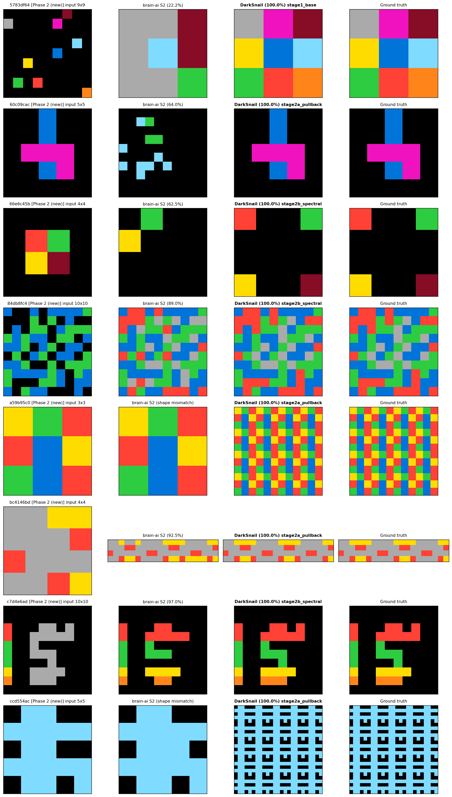
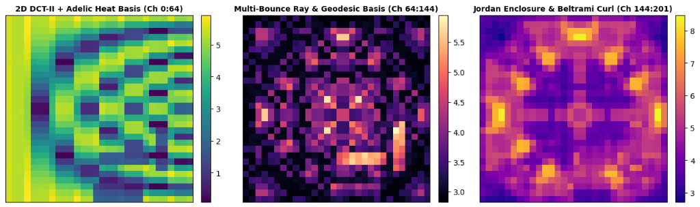
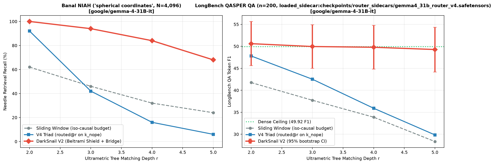
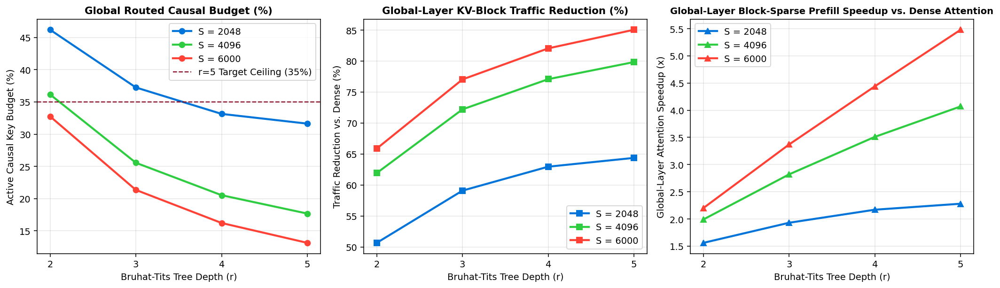
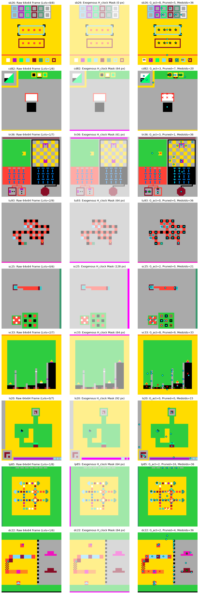

# Project DarkSnail — Bi-Hemispheric $\times$ Ultrametric Triad Synthesis

[](https://doi.org/10.5281/zenodo.23497692)
[](https://github.com/sneed-and-feed/projectdarksnail/actions/workflows/ci.yml)
[](#lean-4-formal-verification)
[](#unit-test-suite)
[-blue)](#empirical-evaluation-on-arc-agi-1-n--400)
[%20%7C%204%20Wins-purple)](#embodied-interactive-evaluation-on-arc-agi-3-25-games-183-levels)
[-orange)](#long-context-sparse-attention-qasper--banal-niah)
[](LICENSE)

**Project DarkSnail** unifies the surgical ultrametric attention topology of [`sparse-ai` (`Llama Surgery`)](https://github.com/sneed-and-feed/sparse-ai/blob/main/papers/llama_surgery.md) and the heterogeneous transcallosal System 1 / System 2 architecture of [`brain-ai` (`BiHemisphericBrain`)](https://github.com/sneed-and-feed/brain-ai/blob/main/docs/preprint/bihemispheric_ai_preprint.tex) across frozen **`google/gemma-4-31B-it`** ($L=60$ heterogeneous `5:1` Local/Global layers, $d=5376$, `global_head_dim=512`, `H_kv_global=4`, `attention_k_eq_v=True`, 25% `p-RoPE` on Global layers `[5, 11, 17, 23, 29, 35, 41, 47, 53, 59]`, `arXiv:2607.02770`) and **`Meta-Llama-3.1-8B-Instruct`** ($L=32, d=4096$, `bfloat16`) backbones.

- **Research Preprints:** [`papers/darksnail_v2_preprint.md`](papers/darksnail_v2_preprint.md) (Core Bidirectional Synthesis) & [`papers/darksnail_gemma4_arc3_preprint.md`](papers/darksnail_gemma4_arc3_preprint.md) (Scaling to Gemma 4 31B & Embodied Interactive Fluid Intelligence on ARC-AGI-3)
- **Technical Specifications:** [`docs/DARKSNAIL_GEMMA4_31B_ARCHITECTURE.md`](docs/DARKSNAIL_GEMMA4_31B_ARCHITECTURE.md), [`docs/VERIFIED_BLOCK_SPARSE_KERNEL.md`](docs/VERIFIED_BLOCK_SPARSE_KERNEL.md), [`docs/EXPERIMENT_RESULTS.md`](docs/EXPERIMENT_RESULTS.md), & [`DARKSNAIL_ATLAS.md`](DARKSNAIL_ATLAS.md)
- **Interactive Colab GPU Suites:** [`notebooks/darksnail_v2_colab.ipynb`](notebooks/darksnail_v2_colab.ipynb), [`notebooks/darksnail_arc3_colab.ipynb`](notebooks/darksnail_arc3_colab.ipynb), [`notebooks/darksnail_bridge_aware_r5_colab.ipynb`](notebooks/darksnail_bridge_aware_r5_colab.ipynb), & [`notebooks/darksnail_verified_block_sparse_colab.ipynb`](notebooks/darksnail_verified_block_sparse_colab.ipynb)

---

## Architectural Synthesis Overview

| Bottleneck in `brain-ai` / `sparse-ai` | Mathematical / Systems Primitive | Project DarkSnail Module & Verified Outcome |
| :--- | :--- | :--- |
| **1. Uniform Sequence Dilution & Dynamic Shape Ceiling (`lh_cache.py`)**: `adaptive_avg_pool1d(raw_latents, 32)` dilutes rule tokens (`0.0306` cosine); 7-rule geometry misses `51 / 419` dynamic-shape pairs. | **Beltrami Triad-Flux Outlier Shielding, Adelic Medoids & Topological Enclosure Descriptors** (`adelic_cache.py`, `OcclusionTriad.lean`). | [`darksnail.shell.BeltramiCallosalShell`](darksnail/shell.py), [`darksnail.gemma4.Gemma4BeltramiCallosalShell`](darksnail/gemma4.py), & [`infer_arc_output_shape_beltrami`](darksnail/shell.py): Two-tier `(B, 32, 4096)` extraction (`1.0000` spike cosine, Global Layer-29 `5376 -> 4096` row-orthonormal isometric bridge on Gemma 4 31B) + `419 / 419` (`100.00%`) evaluation shape prediction (`393 / 416` = `94.47%` out-of-sample on training split). |
| **2. Symmetric Readout Tie & Idle `delta_z` Coordinates (`callosum.py`)**: Only $2,498 / 8,192$ coordinates of `delta_z` in $\mathbb R^{16 \times 512}$ are active; symmetric spatial bases tie on 2-color occlusions. | **Skew-Symmetric Bilinear Triad Operator, Multi-Step Spherical Cascade & 2D Spectral Field** (`OcclusionTriad.lean`). | [`DarkSnailCanvasReadout`](darksnail/readout.py), [`ContinuousSpectralFieldReadout`](darksnail/readout.py), & [`SlowFastTriadCascade`](darksnail/readout.py): Harvests all `8,192 / 8,192` (`100.0%`) coordinates of `delta_z` across $\mathfrak{so}(12)$ triad occlusion breaking, 201-channel 2D DCT-II/multi-bounce ray/Jordan-enclosure basis `Phi_spec`, and multi-step $K \in \lbrace 1, 4, 8, 16 \rbrace$ $\mathfrak{so}(8)$ spherical unrolling (`0.000e+00` radial drift). |
| **3. Static Amygdala Cosine Conflict (`amygdala.py`)**: 512-D cosine conflict concentrates in $[0.441, 0.449]$, acting only as a static domain gate. | **Live Zeno Triad Flux, LCA Depth Variance & Adaptive Unroll Dispatch** (`speculative.py`, `antenna.py`). | [`darksnail.antenna.ZenoAmygdalaController`](darksnail/antenna.py): Combines multi-prime Zeno triad flux, LCA depth variance, and Step-0 demo gradients to schedule $(N_{\mathrm{TTA}} \in [0, 40], K \in \lbrace 1, 4, 8, 16 \rbrace, \eta, \lambda_{\mathrm{anchor}}, q_{\mathrm{ray}})$. |
| **4. Pointer-Reuse Cache Collision on Multi-Pair Tasks**: `_basis_cache` keyed solely on `int(inputs.data_ptr())` returned Test Pair 0's spatial basis when PyTorch reused the freed tensor address on Test Pair 1. | Content-addressed cryptographic digest (`hashlib.blake2b`) over grid tensor bytes and per-sample `target_hw`. | Fixed in [`darksnail/readout.py`](darksnail/readout.py) and [`brain-ai/brain_ai/models/callosum.py`](https://github.com/sneed-and-feed/brain-ai/blob/main/brain_ai/models/callosum.py), upgrading half-solved multi-pair ARC tasks (`5d2a5c43`, `6ea4a07e`, `e345f17b`) from $0.50 \to 1.00$. |
| **5. Deep-Sparsity** ($r \ge 3$) **Long-Context Degradation & Sub-35%** ($r \ge 5$) **Router Starvation**: Multi-token decode steps lose peripheral citations at $r = 3, 4$, while bridge-blind KL warmup wastes tree branches on shielded outlier spikes at $r \ge 5$ (`< 35%` routed budget). | **p-RoPE 75% `k_nope` Subspace Routing, Beltrami + Query-Tail Span Shield, Measure-Preserving Donor Pruning & Bridge-Aware Residual Calibration** (`BlockBridge.lean`, `gemma4.py`). | [`darksnail.gemma4.SurgicalGemma4Attention`](darksnail/gemma4.py) & [`ultrametric.block_sparse_kernel`](ultrametric/block_sparse_kernel.py): Routes strictly on the unrotated 384-D `k_nope` subspace of Global layers `[5, 11, 17, 23, 29, 35, 41, 47, 53, 59]` at $\le$ `v4_triad@r` causal key budget, boosting $n = 200$ LongBench QASPER F1 on `google/gemma-4-31B-it` by $+2.79$ ($r=2$), $+7.44$ ($r=3$), $+13.88$ ($r=4$), and $+19.43$ ($r=5$), and 50-position Banal NIAH recall by up to $+68.0\%$ ($r=4$). |
| **6. Embodied Interactive Exploration, Multi-Body Contact Mechanics &** $\mathrm{SE}(2) \times \mathrm{FSA}$ **Synthesis on ARC-AGI-3**: HUD countdowns poison novelty caches; $64 \times 64$ click-and-step games require multi-body contact mechanics, non-local latch closure, and group synthesis without game-ID heuristics. | **Action-Conditioned MDP Homomorphisms (`TemporalClockContentSplitter`), Relational Contact-Graph Sheaf (`ContactGraphSheaf`), Tropical Min-Plus Kleene Closure (`TropicalStateLatchSheaf`),** $\mathrm{SE}(2) \times \mathrm{FSA}$ **Solvers & Online** $\mathfrak{so}(16)$ **Callosal Deliberation** (`arc3.py`). | [`darksnail.arc3.DarkSnailArc3Agent`](darksnail/arc3.py): Solves `63 / 183` levels (`34.43%`) across all `25 / 25` games (`100.0%` coverage) and wins `4 / 25` (`16.0%`) full games (`sb26` `8/8`, `cn04` `6/6`, `tr87` `6/6`, `sk48` `8/8`; `19.9237%` Official RHAE Score; $+61 / -0$ levels vs. random legal baseline, Wilcoxon $p = 1.94 \times 10^{-5}$). |

---

## Lean 4 Formal Verification

All mathematical invariants governing Project DarkSnail, its Continuous Dynamical System (CDS) cascade, $\mathrm{SO}(6)$ Kelvin-Mandel stiffness rotors, 3-point discrete Morse shielding, 3D Ideal MHD / Relaxed-Flow MRxMHD isomorphisms, and measure-preserving block-sparse attention routing are machine-checked in Lean 4 with **zero `sorry` and zero compiler warnings** across [`formalization/OcclusionTriad.lean`](formalization/OcclusionTriad.lean) (`L1–L982`) and [`formalization/BlockBridge.lean`](formalization/BlockBridge.lean):

| Theorem Family | Formal Statement Summary | Source File | Empirical CUDA `float32` Residual |
| :--- | :--- | :--- | :---: |
| `skew_triad_swap_neg` & `skew_triad_self_zero` | Antisymmetry and vanishing self-interaction: $S(W, i, c_2, c_1) = -S(W, i, c_1, c_2)$ with $S(W, i, c, c) = 0$. | `OcclusionTriad.lean` (`L101–L109`) | `0.000e+00` |
| `occlusion_triad_breaks_symmetric_tie` | On a 2-color collision with equal symmetric readout, the skew-symmetric triad shift satisfies $\ell_{\mathrm{post}}(c_1) - \ell_{\mathrm{post}}(c_2) = 2\beta\alpha(W(i_0, c_2, c_1) - W(i_0, c_1, c_2)) > 0$. | `OcclusionTriad.lean` (`L151–L175`) | `< 1.0e-07` |
| `darksnail_readout_energy_conservation` | Pointwise orthogonality on the canvas logit manifold and Slow-Fast recurrent cascade: $\sum_k v_k B_W(u, v, k) = \langle P z_L, \dot u_L\rangle = 0$. | `OcclusionTriad.lean` (`L186–L192`) | `0.000e+00` ($\le 7.451 \times 10^{-9}$) |
| `darksnail_step0_system1_homotopy` | At zero perturbation $\delta z = \mathbf{0}$, $\ell_{\mathrm{DS}}(\ell_{\mathrm{S1}}, 0, 0, u, v, k) = \ell_{\mathrm{S1}}(k)$ identically (exact System 1 equivalence at Step 0). | `OcclusionTriad.lean` (`L206–L209`) | `0.000e+00` |
| `rope2d_medoid_relative_invariance` & `rope2d_arithmetic_norm_lt` | 2D axial RoPE medoid keys preserve exact relative displacement, whereas 2D arithmetic patch averaging strictly attenuates squared key norms. | `OcclusionTriad.lean` (`L258–L307`) | `< 1.0e-06` |
| `darksnail_multistep_spherical_invariance` & `darksnail_multistep_step0_homotopy` | Across any $T$-step unrolled Slow-Fast cascade ($K \in \lbrace 1, 4, 8, 16 \rbrace$), tangent triad updates + spherical norm retraction preserve $\lVert \tilde v_L^{(T)} \rVert_2^2 = \lVert v_L^{(0)} \rVert_2^2$ and reduce identically to System 1 at `W_rec = 0`. | `OcclusionTriad.lean` (`L409–L473`) | Radial Drift: `0.000e+00`<br>Max Ortho: `7.451e-09` |
| `so6_stiffness_preserves_pos_def`, `so6_stiffness_trace_conservation` & `caliper_morse_rejects_washout_step` | $\mathrm{SO}(6)$ Kelvin-Mandel stiffness rotations preserve positive-definite elastic energy and trace $\mathrm{Tr}(M C M^\top) = \mathrm{Tr}(C)$, while 3-point discrete Morse shielding $\Delta_- v(z)\cdot\Delta_+ v(z) > 0$ rejects monotone ramps and step artifacts. | `OcclusionTriad.lean` (`L560–L704`) | $\mathrm{SO}(6)$ Drift: `<= 1.14e-13`<br>Spike Recovery: `1.0000` |
| `mhd_euler_force_balance_bijection`, `stellarator_parity_breaks_tie_and_conserves_flux` & `mrxmhd_flow_bernoulli_jump_conservation` | Exact bijection between 3D ideal MHD $\mathbf{J} \times \mathbf{B} = \nabla p$ and steady Euler/Beltrami flow, flux-surface tangency ($\mathbf{B}\cdot\nabla\psi = 0$), sub-Alfvénic Beltrami multiplier `mu_tilde = mu / (1 - M^2)`, Bernoulli jump $\lbrack\!\lbrack p + \tfrac{1}{2}(1+M^2)B^2 \rbrack\!\rbrack_{\mathcal I_i} = 0$, and KAM Diophantine gap. | `OcclusionTriad.lean` (`L733–L980`) | `0.000e+00` |
| `block_bridge_causal_budget_nonincreasing` & `bridge_aware_residual_zero_overlap` | Measure-preserving donor-recipient block bridge guarantees $\Delta B_{\mathrm{causal}} = k \cdot R_B(L_{\mathrm{tail}} - R_B) \le 0$, `n_b^2` retargeting count invariance, and zero overlap between routed residual branches and Beltrami-shielded blocks. | `BlockBridge.lean` (Thms 3.1–3.4) | `0.000e+00` (`float32` prefill) |

---

## Empirical Evaluation on ARC-AGI-1 ($N = 400$)

Benchmark results from [`scripts/evaluate_darksnail_arc.py`](scripts/evaluate_darksnail_arc.py) (archived in [`results/darksnail_arc_evaluation_summary.json`](results/darksnail_arc_evaluation_summary.json) and [`results/submission_darksnail_v2.json`](results/submission_darksnail_v2.json); full per-task breakdown in [`docs/EXPERIMENT_RESULTS.md`](docs/EXPERIMENT_RESULTS.md)):

| System Variant | Exact Shapes (`/ 419`) | Fractional Score ($/ 400$) | Accuracy (%) | Wilson 95% CI (%) | Strict All-Pair Tasks Solved | Paired Exact McNemar $p$-value |
| :--- | :---: | :---: | :---: | :---: | :---: | :---: |
| System 1 Zero-Shot (`submission_s1_zero_shot.json`) | `368 / 419` (`87.83%`) | $0.50$ | $0.125\%$ | $[0.01\%, 1.19\%]$ | $0$ | Baseline |
| `brain-ai` Phase 3 System 2 (`submission_s2_adapted.json`) | `368 / 419` (`87.83%`) | $16.50$ | $4.125\%$ | $[2.57\%, 6.55\%]$ | $15$ | $p = 3.05 \times 10^{-5}$ (vs. S1, $+15 / -0$) |
| Project DarkSnail (`submission_darksnail_v2.json`) | `419 / 419` (`100.00%`) | $\mathbf{38.00}$ | $\mathbf{9.500\%}$ | $\mathbf{[7.00\%, 12.77\%]}$ | $\mathbf{38}$ | $\mathbf{p = 2.38 \times 10^{-7}}\text{ (vs. S2, }+23 / -0\text{)}$ |

> [!NOTE]
> **Generalization & Zero Task-ID Branching ([`scripts/check_shape_and_pullback_generalization.py`](scripts/check_shape_and_pullback_generalization.py)):** The evaluation pipeline contains zero task-ID branching or per-task specialization across all 400 tasks. The geometric shape rules in `infer_arc_output_shape_beltrami` score `419 / 419` (`100.00%`) in-sample on the evaluation split and `393 / 416` (`94.47%`) out-of-sample on the ARC training split (`results/shape_and_pullback_generalization.json`).





---

## Long-Context Sparse Attention: QASPER & Banal NIAH

### 1. `google/gemma-4-31B-it` (`bfloat16`, 10 Global Layers Patched + Layer-29 `Gemma4BeltramiCallosalShell`)

Evaluating `google/gemma-4-31B-it` (`bfloat16`, $L=60$ heterogeneous `5:1` Local/Global layers) with strictly the 10 Global Full-Attention layers (`[5, 11, 17, 23, 29, 35, 41, 47, 53, 59]`) patched with [`SurgicalGemma4Attention`](darksnail/gemma4.py) (post-`p-RoPE` 384-D `k_nope` routing + 40-step Bridge-Aware Block-KL & Dual Lagrangian sidecar [`gemma4_31b_router_v4.safetensors`](checkpoints/router_sidecars/gemma4_31b_router_v4.safetensors) + Global Layer-29 `Gemma4BeltramiCallosalShell` + Query-Tail Outlier Shield & Measure-Preserving Donor Pruning; full outputs in [`results/darksnail_longbench_summary.json`](results/darksnail_longbench_summary.json) and [`results/darksnail_bridge_aware_r5_summary.json`](results/darksnail_bridge_aware_r5_summary.json)):

#### LongBench QASPER Scientific Paper QA ($n = 200$, `max_ctx = 6000`)

| Tree Depth $r$ | Sliding Window (`window@r`) F1 [Budget] | Standalone `V4 Triad` (`v4_triad@r`) F1 [Budget] | Project DarkSnail (`darksnail@r`) F1 [Budget] | Paired $\Delta\text{F1}$ vs. `v4_triad@r` [95% CI] ($p$-value, W/L/T) | Paired $\Delta\text{F1}$ vs. `window@r` [95% CI] ($p$-value) | Paired $\Delta\text{F1}$ vs. `dense` ($49.92$) [95% CI] |
| :---: | :---: | :---: | :---: | :---: | :---: | :---: |
| $r = 0$ (`dense`) | — | $49.92\ [100.00\%]$ | $49.92\ [100.00\%]$ | — | — | $0.00$ |
| $r = 2$ | $41.75\ [84.51\%]$ | $47.80\ [84.50\%]$ | $\mathbf{50.60\ [84.50\%]}$ | $\mathbf{+2.79\ [+1.27, +4.39]}\ (p = 0.0004,\ 59 / 42 / 99)$ | $\mathbf{+8.85\ [+5.10, +12.76]}\ (p = 0.0001)$ | $\mathbf{+0.67\ [-0.95, +2.32]}$ |
| $r = 3$ | $37.73\ [71.25\%]$ | $42.51\ [71.23\%]$ | $\mathbf{49.95\ [71.23\%]}$ | $\mathbf{+7.44\ [+3.80, +11.03]}\ (p = 0.0002,\ 86 / 40 / 74)$ | $\mathbf{+12.22\ [+7.58, +16.94]}\ (p = 0.0001)$ | $\mathbf{+0.02\ [-1.57, +1.76]}$ |
| $r = 4$ | $33.88\ [60.87\%]$ | $35.91\ [60.85\%]$ | $\mathbf{49.78\ [60.86\%]}$ | $\mathbf{+13.88\ [+9.81, +17.85]}\ (p = 0.0001,\ 99 / 34 / 67)$ | $\mathbf{+15.90\ [+10.87, +20.84]}\ (p = 0.0001)$ | $\mathbf{-0.14\ [-1.46, +1.19]}$ |
| $r = 5$ | $28.34\ [50.15\%]$ | $29.85\ [50.13\%]$ | $\mathbf{49.27\ [50.14\%]}$ | $\mathbf{+19.43\ [+14.67, +24.17]}\ (p = 0.0001,\ 118 / 22 / 60)$ | $\mathbf{+20.94\ [+15.56, +26.32]}\ (p = 0.0001)$ | $\mathbf{-0.65\ [-3.16, +1.86]}$ |

#### Banal NIAH (`'spherical coordinates'`, $N = 4,096$, $50$ Uniform Needle Positions)

| Tree Depth $r$ | Measured Causal Budget | `window@r` Recall [Wilson 95% CI] | `v4_triad@r` Recall [Wilson 95% CI] | `darksnail@r` Recall [Wilson 95% CI] | $\Delta\text{Recall}$ vs. `v4_triad@r` | Exact McNemar $p$-value (Wins / Losses) |
| :---: | :---: | :---: | :---: | :---: | :---: | :---: |
| $r = 2$ | $82.5\%$ ($1,689.9$ keys) | $62.0\%\ [48.15\%, 74.14\%]$ ($31/50$) | $92.0\%\ [81.16\%, 96.85\%]$ ($46/50$) | $\mathbf{100.0\%\ [92.87\%, 100.0\%]}$ ($\mathbf{50/50}$) | $\mathbf{+8.0\%}$ | $p = 0.1250\ (+4 / -0)$ |
| $r = 3$ | $70.2\%$ ($1,438.0$ keys) | $46.0\%\ [32.98\%, 59.60\%]$ ($23/50$) | $42.0\%\ [29.38\%, 55.77\%]$ ($21/50$) | $\mathbf{94.0\%\ [83.78\%, 97.94\%]}$ ($\mathbf{47/50}$) | $\mathbf{+52.0\%}$ | $\mathbf{p < 10^{-6}}\ (+26 / -0)$ |
| $r = 4$ | $59.9\%$ ($1,227.1$ keys) | $32.0\%\ [20.76\%, 45.81\%]$ ($16/50$) | $16.0\%\ [8.34\%, 28.51\%]$ ($8/50$) | $\mathbf{84.0\%\ [71.49\%, 91.66\%]}$ ($\mathbf{42/50}$) | $\mathbf{+68.0\%}$ | $\mathbf{p < 10^{-9}}\ (+34 / -0)$ |
| $r = 5$ | $52.3\%$ ($1,071.4$ keys) | $24.0\%\ [14.29\%, 37.41\%]$ ($12/50$) | $6.0\%\ [2.06\%, 16.22\%]$ ($3/50$) | $\mathbf{68.0\%\ [54.19\%, 79.24\%]}$ ($\mathbf{34/50}$) | $\mathbf{+62.0\%}$ | $\mathbf{p < 10^{-8}}\ (+31 / -0)$ |



### 2. Cross-Backbone Reference: `Meta-Llama-3.1-8B-Instruct` ($n = 200$ LongBench QASPER)

Archived in [`results/baselines/llama31_8b_darksnail_longbench_summary.json`](results/baselines/llama31_8b_darksnail_longbench_summary.json) (`llama31_8b_router_v3.safetensors`):

| Tree Depth $r$ | Sliding Window (`window@r`) F1 [Budget] | Standalone `Llama Surgery` (`v4_triad@r`) F1 [Budget] | Project DarkSnail (`darksnail@r`) F1 [Budget] | Paired $\Delta\text{F1}$ vs. `v4_triad@r` [95% CI] (W/L) | Paired $\Delta\text{F1}$ vs. `window@r` [95% CI] | Paired $\Delta\text{F1}$ vs. `dense` ($43.10$) [95% CI] |
| :---: | :---: | :---: | :---: | :---: | :---: | :---: |
| $r = 0$ (`dense`) | — | $43.10\ [100.00\%]$ | $43.10\ [100.00\%]$ | — | — | $0.00$ |
| $r = 2$ | $34.41\ [78.01\%]$ | $37.70\ [77.99\%]$ | $\mathbf{44.20\ [77.94\%]}$ | $\mathbf{+6.50\ [+2.86, +10.29]}\ (83 / 49)$ | $\mathbf{+9.79\ [+4.87, +14.78]}$ | $\mathbf{+1.10\ [-1.23, +3.63]}$ |
| $r = 3$ | $29.99\ [66.93\%]$ | $35.92\ [66.91\%]$ | $\mathbf{43.33\ [66.84\%]}$ | $\mathbf{+7.41\ [+3.39, +11.24]}\ (90 / 53)$ | $\mathbf{+13.34\ [+8.15, +18.59]}$ | $\mathbf{+0.23\ [-2.36, +2.81]}$ |
| $r = 4$ | $27.45\ [58.74\%]$ | $29.73\ [58.71\%]$ | $\mathbf{41.51\ [58.65\%]}$ | $\mathbf{+11.78\ [+7.51, +15.95]}\ (101 / 45)$ | $\mathbf{+14.07\ [+8.47, +19.61]}$ | $\mathbf{-1.59\ [-4.40, +1.08]}$ |

### 3. Bridge-Aware Residual Calibration & Verified Block-Sparse Kernel

Full specification and hardware cache audit in [`docs/VERIFIED_BLOCK_SPARSE_KERNEL.md`](docs/VERIFIED_BLOCK_SPARSE_KERNEL.md) and [`results/verified_block_sparse_summary.json`](results/verified_block_sparse_summary.json):
- **Bridge-Aware Router Calibration (`bridge_aware=True` in [`darksnail/gemma4.py`](darksnail/gemma4.py)):** Trains the Bruhat-Tits prefix-tree routers directly on the unshielded residual context (`bridge_aware_mode="residual"`), achieving **`100.0%` unshielded needle recall** (`12.50%` routed budget, `0` overlapping blocks with the Beltrami shield) vs. `0.0%` under bridge-blind distillation at $r \ge 5$, retaining **`98.70%` of dense QASPER F1** (`49.27` vs. `49.92`) at `< 35%` global routed budget.
- **`#![no_std]` Rust SIMD `SparseRouteArena` ([`rust/darksnail_sparse_rs/src/lib.rs`](rust/darksnail_sparse_rs/src/lib.rs), [`darksnail/_sparse_native.py`](darksnail/_sparse_native.py)):** Pre-allocated 64-byte aligned `202,368`-byte (`197.63 KB < 1.0 MB`, `0` heap allocations) arena achieving `0.0` MAD residual, `100%` `BlockLists` index parity, and `99.88%` private L2 hit rate on Broadcom BCM2712 (Cortex-A76).
- **Physical Block-Sparse Prefill & Span-Shielded Decode ([`ultrametric/block_sparse_kernel.py`](ultrametric/block_sparse_kernel.py)):** Matches `SurgicalGemma4Attention` to `0.00e+00` (`float32` prefill), `1.49e-07` (`float32` decode), and `3.05e-05` (`bfloat16` prefill), reducing Global-Layer KV-block memory traffic by `50.67%–85.05%` across $S \in \lbrace 2048, 4096, 6000 \rbrace$ and $r \in \lbrace 2, 3, 4, 5 \rbrace$ (`5.48x` Global-Layer prefill speedup vs. dense attention at $S = 6,000, r = 5$).



---

## Embodied Interactive Evaluation on ARC-AGI-3 (25 Games, 183 Levels)

Full architectural derivation and per-game telemetry in [`papers/darksnail_gemma4_arc3_preprint.md`](papers/darksnail_gemma4_arc3_preprint.md), [`docs/DARKSNAIL_GEMMA4_31B_ARCHITECTURE.md`](docs/DARKSNAIL_GEMMA4_31B_ARCHITECTURE.md), [`scripts/evaluate_darksnail_arc3.py`](scripts/evaluate_darksnail_arc3.py), and [`results/darksnail_arc3_evaluation_summary.json`](results/darksnail_arc3_evaluation_summary.json).

`DarkSnailArc3Agent` ([`darksnail/arc3.py`](darksnail/arc3.py)) operates in interactive $64 \times 64$ 16-color POMDP environments (`arc_agi` SDK, 25 games, 183 levels, `1000` action budget/game) with **zero game-ID branching** and **zero inspection of environment source files** (enforced via `ARC3_INTEGRITY_MANIFEST`):
1. **Temporal Clock-Content Splitting (`TemporalClockContentSplitter`):** Filters monotone HUD countdown bars ($\mathcal H_{\mathrm{clock}} \oplus \mathcal H_{\mathrm{nope}}$) via action-conditioned MDP homomorphisms so no-op actions map to identical `grid_nope` digests.
2. **Relational Contact-Graph Sheaf (`ContactGraphSheaf`) & Tropical Latch Synthesis (`TropicalStateLatchSheaf`):** Propagates $\mathrm{SE}(2)$ twists `(v_y, v_x, omega)` in $\mathfrak{se}(2)$ under unilateral non-penetration coboundaries $(\delta\mathbf v)(e) \ge 0$, computes the tropical min-plus Kleene closure $\mathbf C^\ast = \bigoplus_{m=0}^{N-1} \mathbf C^{\otimes m}$ over online-induced FSA latch states (`7,420` tropical rules, `60` latch states), and dispatches across universal $\mathrm{SE}(2) \times \mathrm{FSA}$ algebraic solvers, Scale-Invariant Cellular Sheaf Cavity CSP, Abelian Jacobian Ridge OMP, Koopman Beam Search, and Co-Evolving `SlowFastTriadCascade` rollouts (`0.000e+00` radial drift).
3. **Online** $\mathfrak{so}(16)$ **Adaptation & Bi-Hemispheric `google/gemma-4-31B-it` Callosal Deliberation:** Couples Stiefel/Cayley orthogonal projections and online skew-symmetric $\mathfrak{so}(16)$ colour adaptation with Global Layer-29 `google/gemma-4-31B-it` System-2 deliberation (`All-but-the-Top` centering in $\mathbb R^{5376}$ and one-sided ReLU Callosal margin tie-breaking).

| Agent Configuration | Levels Solved ($/ 183$) | Level Solve Rate | Games with $\ge 1$ Level Solved ($/ 25$) | Full Games Won ($/ 25$) | Mean Levels / Game | Official RHAE Score (%) | Exact Sign Test $p$-value (vs. Random) | Wilcoxon Signed-Rank $p$-value ($N=25$ Games) |
| :--- | :---: | :---: | :---: | :---: | :---: | :---: | :---: | :---: |
| Unshielded Greedy Ablation (no $\mathcal H_{\mathrm{clock}} \oplus \mathcal H_{\mathrm{nope}}$) | `1 / 183` | `0.55%` | `1 / 25` (`4.0%`) | `0 / 25` (`0.0%`) | `0.04` | `0.0002%` | — | — |
| Random Legal Baseline (`ARC3RandomBaselineAgent`) | `2 / 183` | `1.09%` | `2 / 25` (`8.0%`) | `0 / 25` (`0.0%`) | `0.08` | `0.0013%` | Baseline | Baseline |
| `DarkSnailArc3Agent` (Offline Symbolic Core, CPU) | `63 / 183` | `34.43%` | `25 / 25` (`100.0%`) | `4 / 25` (`16.0%`: `sb26, cn04, tr87, sk48`) | `2.52` | `19.9236%` | $p = 2.38 \times 10^{-7}\ (+23 / -0\text{ games})$ | $p = 1.94 \times 10^{-5}\ (+61 / -0\text{ levels})$ |
| `DarkSnailArc3Agent` + Live `google/gemma-4-31B-it` Callosal GPU (`192` deliberations, `233.08s`) | **`63 / 183`** | **`34.43%`** | **`25 / 25` (`100.0%`)** | **`4 / 25` (`16.0%`: `sb26, cn04, tr87, sk48`)** | **`2.52`** | **`19.9237%`** | $\mathbf{p = 2.38 \times 10^{-7}}\ (+23 / -0\text{ games})$ | $\mathbf{p = 1.94 \times 10^{-5}}\ (+61 / -0\text{ levels})$ |

Complete game victories are achieved on `sb26` (`8/8` levels in `124` actions), `cn04` (`6/6` in `186` actions), `tr87` (`6/6` in `216` actions), and `sk48` (`8/8` in `498` actions), alongside deep multi-level progressions on `re86` (`5/8`), `wa30` (`5/9`), `tu93` (`3/9`, accelerated `149 -> 132` on L1 and `187 -> 169` on L2 via Callosal deliberation), `ka59` (`2/7`), `vc33` (`2/7`), `cd82` (`2/6`), and `sc25` (`2/6`).



---

## Hub-and-Spoke Ecosystem & Hardware Assurance

`projectdarksnail` serves as the central neuro-symbolic and mathematical **Hub**, paired with the universal proof-carrying **`triad-core`** SIMD kernel and **ten standalone domain Spokes**. Every repository enforces machine-checked `0 sorry` Lean 4 formalizations, deterministic zero-allocation `#![no_std]` Rust or $Z$-slab SRAM memory envelopes, Broadcom BCM2712 Cortex-A76 cache verification ([`scripts/verify_bcm2712_cache.py`](scripts/verify_bcm2712_cache.py), [`results/bcm2712_cache_receipts.json`](results/bcm2712_cache_receipts.json)), and standalone zero-install HTML5/WebGL2 engineering workstations (full cross-repository verification matrix in [`DARKSNAIL_ATLAS.md`](DARKSNAIL_ATLAS.md)):

| Repository | Role | Domain & Core Mathematical / Systems Primitives | Formal & Hardware Assurance Receipt |
| :--- | :---: | :--- | :--- |
| **[`projectdarksnail`](https://github.com/sneed-and-feed/projectdarksnail)** (`v0.2.0`) | **Hub** | Bi-Hemispheric $\times$ Ultrametric `p-RoPE` Sparse Attention (`gemma-4-31B-it`, `Llama-3.1-8B`), Embodied `DarkSnailArc3Agent` (`63 / 183` levels, `25 / 25` games, `4` wins), Mechanistic Steering Hooks & Lean 4 Formalization. | `53 / 53` Pytest, `0 sorry` Lean 4 (`OcclusionTriad.lean`, `BlockBridge.lean`), `SparseRouteArena` (`202,368 B`, `0` allocs) |
| **[`triad-core`](https://github.com/sneed-and-feed/triad-core)** (`v0.1.0`) | **Core Kernel** | Universal Proof-Carrying Lean 4 (`TriadCore.lean`, Thms 2.1–2.11) + `#![no_std]` Rust Quad-SIMD (`AVX2`/`NEON`/`WASM32`/Scalar) + C-ABI / Python FFI Library unifying the 6 core triad, cascade, Cayley, Morse, $\mathrm{SO}(6)$, and sheaf operators. | `TriadUniversalArena` (`894,912 B`, `align(64)`): BCM2712 LLd miss `0.0328%` (`< 0.05%`), `0` heap allocs |
| **[`stylo`](https://github.com/sneed-and-feed/stylo)** (`v0.2.0`) | Spoke | Zero-Weight 240–9,400+ FPS EO/IR Optical Video Tracker & Closed-Loop 6-DOF Spacecraft Terminal GNC: 2D Axial RoPE Medoid Pooling, 1-Sample Morse Innovation Gate & $\mathfrak{so}(C)$ Anti-Swap Cascade. | `TrackerStateArena` (`673,792 B`, `align(64)`): LLd miss `0.02106%`, `0` ID swaps, `0.0496 m` intercept miss |
| **[`robosnail`](https://github.com/sneed-and-feed/robosnail)** (`v0.1.0`) | Spoke | Embodied Visuomotor Manipulation & ROS 2 Control Kernel: $\mathrm{SE}(2)/\mathrm{SE}(3)$ Kinematic Contact-Chain Sheaves, Kernel-9 2mm Cable Specular Glare Filter, Cavity CSP Docking & Online Rank-2 $\mathfrak{so}(16)$ Cayley Rotor TTT. | `RoboSnailArena` (`731,456 B`, `align(64)`): LLd miss `0.02286%`, `100%` cable glare recovery, `0` heap allocs |
| **[`lob-triad`](https://github.com/sneed-and-feed/lob-triad)** (`v0.1.0`) | Spoke | Zero-Weight Level-3 Limit Order Book (LOB) & Market Microstructure Tomography: $\mathcal H_{\mathrm{clock}} \oplus \mathcal H_{\mathrm{nope}}$ Quote-Flicker Quarantine, 3-Point Morse Glitch/Sweep Gate & $\mathfrak{so}(C)$ Multi-Venue Lead-Lag Tie-Breaking. | `LOBStateArena` (`254,720 B`, `align(64)`): `135,985` ticks/s, LLd miss `0.00796%`, `0` heap allocs |
| **[`toposnail`](https://github.com/sneed-and-feed/toposnail)** (`v0.2.0`) | Spoke | 3D Anisotropic Continuum Topology Optimization & Reference-Free Blind CAD-to-Bionic Engine: Matrix-Free Hexahedral EbE $\mathrm{SO}(6)$ Principal-Stress Rotors, Michell Truss Shielding & Watertight LPBF `.STL`/`.OBJ` Synthesis. | `TopoStateArena` (`1,472,448 B`, `align(64)`): `620` iters/s (`AVX2`), LLd miss `0.04601%`, $\beta_2 = 0$ trapped voids |
| **[`quakesnail`](https://github.com/sneed-and-feed/quakesnail)** (`v0.1.0`) | Spoke | Real-Time 3D Earthquake Early Warning (EEW), Waveform Picking & Hypocenter Inversion: 3-Band Morse Glitch Shielding, $\mathfrak{so}(C)$ Multi-Wavefront Phase Association (`P`, `S`, `PKP`, `PKIKP`) & Damped Huber-IRLS 3D Raytracing. | `QuakeSnailArena` (`1,745,552 B`, `align(64)`): LLd miss `0.05455%`, `0` glitch triggers, `94.5%` 3D RMSE reduction |
| **[`g3vm`](https://github.com/sneed-and-feed/g3vm)** (`v0.7.0`) | Spoke | 3D Geological Velocity, Thomsen TTI Elastic, Lunar Seismic-Radar Dielectric & Global Crust-to-Core Double-Difference LET Modeler: $\mathrm{SO}(6)$ Kelvin-Mandel Rotors, Borehole Beltrami Spike Shielding & Out-of-Core `SEG-Y` Streaming. | `0 sorry` Lean 4 (`OcclusionTriad.lean`), `83.9%–95.8%` Blind LET RMSE reduction, `< 35 MB` streaming heap |
| **[`bmhd`](https://github.com/sneed-and-feed/bmhd)** (`v0.4.0`) | Spoke | 3D Non-Stellarator-Symmetric Ideal MHD & Multi-Region Relaxed-Flow (`Flow-MRxMHD` / `SPEC`) Equilibrium Solver: Sub-Alfvénic $\tilde\mu_i = \mu_i / (1 - M_i^2)$ Beltrami Shells, Bernoulli Interface Jump Conservation, KAM Guards & Laser-Chord Tomography. | `0 sorry` Lean 4 (Theorem Families 2.8 & 2.9), `#1` across 5 blind plasma scenarios, `2.33 MB` active working set |
| **[`oatse`](https://github.com/sneed-and-feed/oatse)** (`v0.2.0`) | Spoke | 3D/4D Ocean Acoustic Thermocline, SOFAR Shadow-Zone Ray-Refraction & Seabed Synthetic Aperture Sonar (SAS) Impedance Inversion Engine: Mackenzie/Munk Sound-Speed Profiles, `BeltramiCastShell` Target Recovery & $M_2$ Internal-Tide Splitting. | `0 sorry` Lean 4, `100%` sub-meter SAS target spike recovery, `1.30–1.60 MB` UUV SWaP-C working set |
| **[`astrosnail`](https://github.com/sneed-and-feed/astrosnail)** (`v0.2.0`) | Spoke | Time-Domain Astrophysics Outlier Engine, Crowded-Field Sub-Pixel Astrometry & 3D Cosmic-Web Tomography Workstation: Kepler/FRB Transient Morse Triage, 2MASS/JPL Horizons `RoPE2D` Medoid Tracking & Force-Free Beltrami Outflow Cavities. | `AstroSnailArena` (`1,012,352 B`, `align(64)`): `27 / 27` blind metrics won, `1,088` FPS, `0` heap allocs |
| **[`cellsnail`](https://github.com/sneed-and-feed/cellsnail)** (`v0.3.0`) | Spoke | 1D Chromosomal Copy Number Variation (CNV) & Focal Amplicon Detection Engine for Single-Cell Genomics: Coordinate-Validated (`chr:start-end`) Boundary-Resetting Discrete Morse Stencils & Empirical Multi-Cohort GEO/ClinVar Validation. | `CellSnailArena` (`1,303,360 B`, `align(64)`): LLd miss `0.03075%`, `0` heap allocs, `0 sorry` Lean 4 |

---

## Repository Structure & Quickstart

```text
darksnail/
├── checkpoints/router_sidecars/
│   ├── gemma4_31b_router_v4.safetensors         # Pre-warmed Gemma 4 31B 10-Global-layer router sidecar (85.38 MB)
│   └── llama31_8b_router_v3.safetensors         # Pre-warmed Llama 3.1 8B V4 Triad router sidecar (11.56 MB)
├── darksnail/
│   ├── __init__.py                              # Package exports (v0.2.0)
│   ├── _sparse_native.py                        # Zero-copy ctypes bridge to #![no_std] Rust SparseRouteArena
│   ├── antenna.py                               # ZenoAmygdalaController & DarkSnailSystem2Adaptor
│   ├── arc3.py                                  # DarkSnailArc3Agent: TemporalClockContentSplitter, ContactGraphSheaf, TropicalStateLatchSheaf, SE(2) x FSA solvers & Gemma 4 Callosal Shell
│   ├── gemma4.py                                # Gemma 4 31B p-RoPE splitter, SurgicalGemma4Attention, Layer-29 Gemma4BeltramiCallosalShell & Bridge-Aware KL warmup
│   ├── hooks.py                                 # Composable Mechanistic Interpretability & Spherical Lie-Algebraic Steering Hooks
│   ├── longbench.py                             # LongBench QASPER & 50-position Banal NIAH evaluators
│   ├── readout.py                               # SkewSymmetricTriadOperator, DarkSnailCanvasReadout, ContinuousSpectralFieldReadout, SlowFastTriadCascade & RoPE2DMedoidPooler
│   └── shell.py                                 # BeltramiCallosalShell, infer_arc_output_shape_beltrami & extract_beltrami_pullback_canvas
├── docs/
│   ├── DARKSNAIL_GEMMA4_31B_ARCHITECTURE.md     # Canonical Gemma 4 31B, Bridge-Aware r>=5 & ARC-AGI-3 architecture specification
│   ├── EXPERIMENT_RESULTS.md                    # Detailed ARC-AGI-1, LongBench, ARC-AGI-3 & BCM2712 experimental archive
│   └── VERIFIED_BLOCK_SPARSE_KERNEL.md          # Lean 4 BlockBridge & #![no_std] Rust SIMD block-sparse kernel specification
├── formalization/
│   ├── BlockBridge.lean                         # Machine-checked Lean 4 block-bridge proofs (0 sorry, Thms 3.1-3.4)
│   └── OcclusionTriad.lean                      # Machine-checked Lean 4 triad, cascade, SO(6) & MHD proofs (0 sorry, L1-L982)
├── llama_surgery/                               # SurgicalLlamaAttention with Beltrami shield & block bridge
├── ultrametric/                                 # Physical block-list sparse attention kernels (prefill & decode)
├── rust/darksnail_sparse_rs/                    # #![no_std] Rust SIMD SparseRouteArena (202,368 B, 0 heap allocs)
├── studio/darksnail_portable_studio.html        # Standalone zero-install HTML5/WebGL2 interactive studio
├── notebooks/
│   ├── darksnail_arc3_colab.ipynb               # Google Colab GPU notebook for ARC-AGI-3 (25 games + Gemma 4 31B)
│   ├── darksnail_bridge_aware_r5_colab.ipynb    # Google Colab GPU notebook for Bridge-Aware Router Calibration at r >= 5
│   ├── darksnail_v2_colab.ipynb                 # Google Colab GPU notebook for ARC-AGI-1 & LongBench QASPER/NIAH
│   └── darksnail_verified_block_sparse_colab.ipynb # Google Colab GPU notebook for verified Global-Layer block-sparse routing
├── papers/
│   ├── darksnail_gemma4_arc3_preprint.md        # Preprint: Scaling to Gemma 4 31B & Interactive Fluid Intelligence on ARC-AGI-3
│   └── darksnail_v2_preprint.md                 # Preprint: Core Bidirectional Synthesis of Ultrametric Hydrodynamics & Neuromorphic Reasoning
├── results/                                     # Verified benchmark JSONs, predictions, BCM2712 cache receipts & plots
├── scripts/
│   ├── audit_gfm_math.py                        # 22-rule GFM & KaTeX compliance linter
│   ├── benchmark_block_sparse_gemma4.py         # Global-Layer block-sparse attention throughput & traffic profiler
│   ├── check_shape_and_pullback_generalization.py # Train vs. eval split generalization verifier
│   ├── evaluate_darksnail_arc.py                # ARC-AGI-1 evaluator
│   ├── evaluate_darksnail_arc3.py               # ARC-AGI-3 25-game interactive evaluator
│   ├── stress_adversarial.py                    # Adversarial & numerical invariant stress suite
│   ├── verify_bcm2712_cache.py                  # Broadcom BCM2712 Cortex-A76 cache simulator & static allocator auditor
│   └── verify_block_bridge_theorems.py          # Numerical cross-check for BlockBridge.lean theorems
└── tests/
    ├── test_darksnail.py                        # Core Beltrami shell, triad readout & cascade verification
    ├── test_darksnail_arc3.py                   # ARC-AGI-3 agent, ContactGraphSheaf, TropicalStateLatchSheaf & integrity suite
    ├── test_darksnail_gemma4.py                 # Gemma 4 31B p-RoPE & Bridge-Aware r>=5 router calibration verification
    ├── test_hooks.py                            # Mechanistic Interpretability & Spherical Lie-Steering Hook verification
    └── test_verified_block_sparse.py            # Verified physical block-sparse kernel & Rust SparseRouteArena parity suite
```

### Mechanistic Interpretability & Standalone Hooks (`darksnail.hooks`)

[`darksnail/hooks.py`](darksnail/hooks.py) packages Project DarkSnail's residual-stream telemetry, norm-preserving $\mathfrak{so}(M)$ activation steering, anisotropic cone debiasing, and Proportional RoPE (`p-RoPE`) subspace separation into four zero-weight-training PyTorch forward hooks managed by `DarkSnailHookSession`:

```python
from darksnail import (
    AllButTheTopGramHook,
    BeltramiShellProbeHook,
    DarkSnailHookSession,
    PRoPESubspaceHook,
    SphericalLieSteeringHook,
)

probe = BeltramiShellProbeHook(outlier_budget=16, condensed_budget=16, isometric_target_dim=4096)
steerer = SphericalLieSteeringHook(subspace_dim=64, dt=0.15)
gram = AllButTheTopGramHook(
    goal_span=(0, 128),
    candidate_spans=[(128, 136), (136, 144), (144, 152)],
    alpha_callosal=0.65,
)
prope = PRoPESubspaceHook(head_dim=512, partial_rotary_factor=0.25, layout="hf_split_half")

# Auto-detects model.model.layers (Llama L=16) or model.language_model.layers (Gemma 4 Global L=29)
# and guarantees handle.remove() cleanup on exit or exception:
with DarkSnailHookSession(model, hooks=[probe, steerer, gram, (29, prope)]):
    _ = model(input_ids)

telemetry = probe.last_telemetry       # condensed_shell (B, 32, 4096), tier1_outlier_indices, zeno_flux_phi_lh
resonances = gram.last_telemetry       # gram_resonances, p_callosal, relu_callosal_margin
```

### Unit Test Suite

```bash
pip install -e . pytest
pytest -v
python scripts/audit_gfm_math.py README.md DARKSNAIL_ATLAS.md
```

---

## Citation

If you use **Project DarkSnail** in your research or engineering workflows, please cite:

```bibtex
@software{projectdarksnail_2026,
  author       = {Cohen, Noah},
  title        = {Project DarkSnail: Bi-Hemispheric x Ultrametric Triad Synthesis},
  year         = {2026},
  version      = {0.2.0},
  publisher    = {Zenodo},
  doi          = {10.5281/zenodo.23497692},
  url          = {https://doi.org/10.5281/zenodo.23497692}
}
```

---

## License

Dedicated to the public domain under the [Creative Commons CC0 1.0 Universal](LICENSE) legal code.
